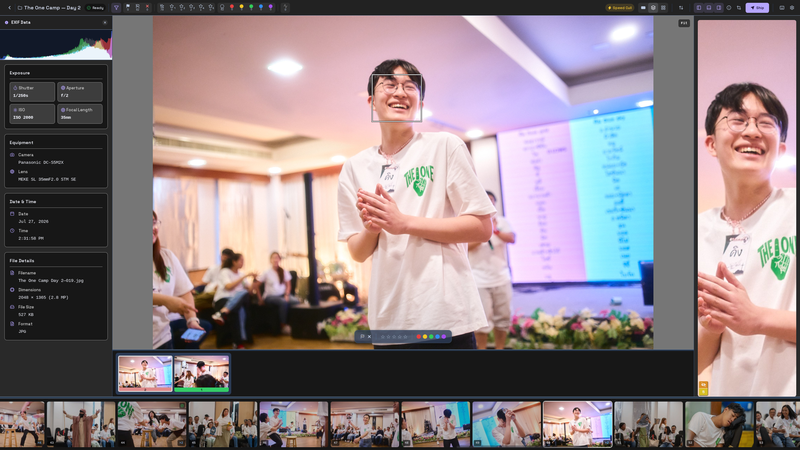

<a id="readme-top"></a>

[![Release][release-shield]][release-url]
[![Build][build-shield]][build-url]
[![Issues][issues-shield]][issues-url]
[![GPL-3.0-or-later][license-shield]][license-url]

<div align="center">
  <a href="https://github.com/NatePhotos/OpenCull">
    
  </a>

  <h1>OpenCull</h1>
  <p>Private, fast photo culling for photographers.</p>
  <p>
    <a href="#try-this-fork">Run this fork</a> ·
    <a href="docs/HOW-IT-WORKS.md">How it works</a> ·
    <a href="https://github.com/NatePhotos/OpenCull">Original project</a>
  </p>
</div>

OpenCull is an offline desktop app for reviewing RAW and JPEG shoots. It opens
camera previews without importing or decoding the RAW files, helps compare
frames, and saves ratings and crops in formats photo editors can read.
Photo analysis stays on your computer. The optional MobileCLIP model is
downloaded only when you request it; photos are never uploaded.

This repository is Wisp's fork of [OpenCull by NatePhotos](https://github.com/NatePhotos/OpenCull).
The combined development version is on `dev`; the upstream releases contain
the original application, not this fork's additions.

<div align="center">
  <a href="docs/images/screenshot.jpg">
    
  </a>
</div>

## Try this fork

### Requirements

- [Rust stable](https://rustup.rs)
- Node.js 22.12+, 24, or 26+ and npm 11 or newer. Node 20, 23 and 25 are
  unsupported. The repository pins Node 22.23.3 and npm 11.21.1.
- [Tauri's platform prerequisites](https://v2.tauri.app/start/prerequisites/)
- A fast JPEG library build: on macOS, install Xcode Command Line Tools and run
  `brew install jpeg-turbo pkgconf`; on Linux and Windows, install CMake and
  NASM (NASM is needed on Intel/AMD).

Clone the fork's `dev` branch and start the desktop app:

```sh
git clone --branch dev --single-branch https://github.com/wispdevon/OpenCull.git
cd OpenCull
nvm install
nvm use
npm install --global npm@11.21.1
npm ci
npm run desktop
```

If Node and npm are already installed, use any versions that meet the
requirements and skip the `nvm` commands. The first run compiles the native
app and may take several minutes. Keep the terminal open; stop the app with
Ctrl+C. Frontend edits reload automatically and Rust edits rebuild the app.

The browser preview is `npm run dev`; it uses sample data and cannot open
folders or memory cards through the native file APIs.

### Desktop commands

| Command | What it does |
|---|---|
| `npm run desktop` | Start the desktop app; automatically enables CUDA when the required NVIDIA runtime is detected on Linux x86_64. |
| `npm run desktop -- --cuda` | Force CUDA AI support on Linux x86_64. |
| `npm run desktop -- --cpu` | Force CPU AI. |
| `npm run desktop -- --nvidia` | Use the tested NVIDIA webview rendering profile on Linux. AI selection remains automatic. |
| `npm run desktop -- --compatibility` | Use the Linux WebKit compatibility rendering profile. |
| `npm run desktop -- --software` | Force software webview rendering on Linux. |
| `npm run build:desktop` | Build the desktop app; CUDA is included automatically when detected on Linux x86_64. |
| `npm run build:desktop -- --cuda` | Force a CUDA-enabled Linux x86_64 build. |
| `npm run build:desktop -- --debug --no-bundle` | Build a debug desktop executable without installer packaging. |

CUDA AI needs an NVIDIA GPU and driver plus CUDA 13.x runtime libraries and
cuDNN 9.x compatible with CUDA 13. The app verifies CUDA at launch and falls
back to CPU if the provider cannot initialize. macOS and Windows builds do not
include CUDA. Webview rendering and AI inference are separate: `--nvidia`
selects a Linux rendering profile, while CUDA accelerates AI models.
See the [CUDA setup and verification guide](docs/CUDA-TRIAL.md) and
[benchmark results](docs/CUDA-BENCHMARK.md).

`npm run desktop` normally starts its own Vite server. If an OpenCull Vite
server is already running on port 1420, the command reuses it; it reports an
error if another app is using that port.

## What you can do

- Review a folder or memory card, combine card sources, and choose which photos
  to copy after culling. Reviewing leaves the card originals untouched.
- Compare RAW/JPEG pairs, browse in filmstrip, grid or stack views, and adjust
  crops, ratings, flags, labels and metadata panels.
- Use local face analysis to compare expressions and sharpness. Optional
  [MobileCLIP grouping](docs/features/MOBILECLIP_GROUPING.md) groups visually
  similar photos; [motion-blur detection](docs/features/MOTION_BLUR.md) can
  label and reject blurry frames.
- Change appearance, layout, keyboard shortcuts and panels in Settings.
  [Settings can be exported and imported](docs/features/SETTINGS_TRANSFER.md).

The [feature guides](docs/features/) cover the experimental options and their
current limits. [How it works](docs/HOW-IT-WORKS.md) explains preview handling,
analysis, and measured performance.

## Keyboard basics

| Key | Action |
|---|---|
| `←` / `→` | Previous / next photo |
| `↑` / `↓` | Previous / next group |
| `P` / `X` / `U` | Pick / reject / clear flag |
| `1`–`5` / `0` | Set star rating / no stars |
| `Space` | Zoom to a face, then back out |
| `Z` | Zoom to the centre, then back out |
| `G` / `F` | Grid view / toggle filmstrip |
| `H` / `.` | Histogram and EXIF / face panel |
| `Caps Lock` | Toggle speed culling |
| `R` | Crop and straighten |

Shortcuts can be changed in **Settings → Keyboard**. The app also shows a
first-launch overview with the common keys and culling flow.

<div align="center">
  
</div>

## Built with

[![Tauri][Tauri-badge]][Tauri-url]
[![Rust][Rust-badge]][Rust-url]
[![React][React-badge]][React-url]
[![TypeScript][TypeScript-badge]][TypeScript-url]
[![Tailwind CSS][Tailwind-badge]][Tailwind-url]
[![ONNX Runtime][ONNX-badge]][ONNX-url]

The optional Linux CUDA build also uses [NVIDIA CUDA][CUDA-url] and
[cuDNN][cuDNN-url]. Third-party software and model licenses are listed in
[`THIRD-PARTY-NOTICES.md`](THIRD-PARTY-NOTICES.md).

## Development and checks

Run these from the repository root with the requirements above installed:

```sh
npm run test:web
npm run test:rust
npm run build:web
npm run check
```

`npm run check` runs the frontend and Rust tests plus the frontend production
build. `npm run build:desktop` creates the native app and installer packages.
For a read-only native check against a folder of photos, see
[Checking it works](docs/HOW-IT-WORKS.md#checking-it-works).

Development in this fork happens directly on `dev`; `main` is the release
branch. Earlier work branch tips are preserved as
[archive tags](docs/BRANCH_ARCHIVE.md). Contributions to this fork should
target `dev`. To contribute to the original project, use
[NatePhotos/OpenCull](https://github.com/NatePhotos/OpenCull).

## License and contact

Copyright © 2026 The OpenCull authors. OpenCull is distributed under the
[GNU General Public License, version 3 or later](LICENSE), without warranty.
See [`THIRD-PARTY-NOTICES.md`](THIRD-PARTY-NOTICES.md) for dependencies,
model credits and their licenses.

Original project and maintainer: [NatePhotos](https://github.com/NatePhotos/OpenCull)
· [Instagram](https://www.instagram.com/natephotos.ny) ·
[email](mailto:natephotos.ny@gmail.com). For issues and feature requests in
this fork, use [wispdevon/OpenCull issues][issues-url].

<p align="right"><a href="#readme-top">Back to top</a></p>

[release-shield]: https://img.shields.io/github/v/release/NatePhotos/OpenCull?include_prereleases&style=for-the-badge
[release-url]: https://github.com/NatePhotos/OpenCull/releases
[build-shield]: https://img.shields.io/github/actions/workflow/status/wispdevon/OpenCull/build.yml?branch=main&style=for-the-badge
[build-url]: https://github.com/wispdevon/OpenCull/actions/workflows/build.yml
[issues-shield]: https://img.shields.io/github/issues/wispdevon/OpenCull.svg?style=for-the-badge
[issues-url]: https://github.com/wispdevon/OpenCull/issues
[license-shield]: https://img.shields.io/badge/license-GPL--3.0--or--later-blue?style=for-the-badge
[license-url]: LICENSE
[Tauri-badge]: https://img.shields.io/badge/Tauri-24C8D8?style=for-the-badge&logo=tauri&logoColor=white
[Tauri-url]: https://tauri.app
[Rust-badge]: https://img.shields.io/badge/Rust-000000?style=for-the-badge&logo=rust&logoColor=white
[Rust-url]: https://www.rust-lang.org
[React-badge]: https://img.shields.io/badge/React-20232A?style=for-the-badge&logo=react&logoColor=61DAFB
[React-url]: https://react.dev
[TypeScript-badge]: https://img.shields.io/badge/TypeScript-3178C6?style=for-the-badge&logo=typescript&logoColor=white
[TypeScript-url]: https://www.typescriptlang.org
[Tailwind-badge]: https://img.shields.io/badge/Tailwind_CSS-06B6D4?style=for-the-badge&logo=tailwindcss&logoColor=white
[Tailwind-url]: https://tailwindcss.com
[ONNX-badge]: https://img.shields.io/badge/ONNX_Runtime-005CED?style=for-the-badge&logo=onnx&logoColor=white
[ONNX-url]: https://onnxruntime.ai
[CUDA-url]: https://developer.nvidia.com/cuda-toolkit
[cuDNN-url]: https://developer.nvidia.com/cudnn
